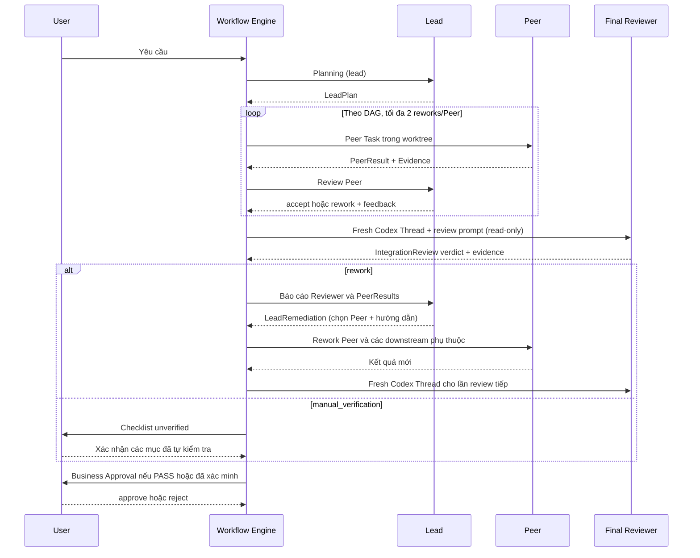

# Agent roles — Lead / Peer / Independent Final Reviewer

## Trách nhiệm

| Role | Nhiệm vụ chính | Không được làm |
|---|---|---|
| `lead` | Lập kế hoạch, chia Peer Task, nhận PeerResult/Evidence, `accept` hoặc `rework`, bổ sung hướng dẫn/gỡ blocker và quyết định khắc phục theo findings | Tự triển khai source, tự kiểm tra và kết luận Final Integration Review |
| `peer` | Thực thi công việc tại source module/worktree, bàn giao artifact, báo cáo test/risks | Tự duyệt kết quả hoặc tự quyết định Business Approval |
| `reviewer` | Final Integration Review độc lập: kiểm tra Acceptance Criteria + Integration Contracts, evidence và source thực tế | Điều phối Peer, sửa source, override Business Approval |
| `user` | Xác minh thủ công nếu cần và Business Approval | — |

## Luồng vận hành

## Fresh session thực sự là gì?

- Mỗi lần Final Integration Review tạo **Task role `reviewer`**, lưu trong `workflow.reviewerTaskIds[]`. `SessionManager` luôn gọi `thread/start`; không dùng `thread/resume`, `thread/fork` hay `leadTaskIds`.
- Mỗi lần reviewer sửa output/schema hoặc review lại sau rework dùng **Codex Thread mới**. Backend còn sử dụng một app-server process chung cho nhiều Threads, nhưng **conversation/session riêng**.
- Reviewer **không** nhận `lead.instructions` hoặc lịch sử các Lead turns. Reviewer nhận input có cấu trúc: yêu cầu gốc, LeadPlan và Acceptance Criteria, Integration Contracts, PeerResult + Git/Test Evidence và module paths, để đánh giá độc lập trên sản phẩm thực tế.
- `config/workspace.local.json` có thể khai báo `reviewer: {cwd,instructions}` (tùy chọn). Khi thiếu reviewer.cwd, mặc định dùng lead.cwd làm điểm khởi đầu **filesystem**, không dùng lại session/role Lead. Các module paths cần đọc có trong prompt.
- `lead` và `reviewer` chạy `read-only` sandbox ở `thread/start` và `readOnly` ở `turn/start`, **ngay cả khi Peer đang YOLO**. Chỉ Peer được chạy trong write sandbox hoặc YOLO theo `CODEX_SECURITY_MODE`. Sandbox phụ thuộc platform và cấu hình Codex/MCP; không phải bảo đảm phân quyền tuyệt đối ngoài process.
- `reviewer` là role nội bộ, `POST /api/tasks` không cho phép người dùng tạo reviewer tùy ý.

## Decision semantics

- Peer Review: Lead trả `LeadReview.reviews[].decision=accept|rework`. `feedback` mô tả bổ sung/làm lại và cách kiểm tra.
- Final Review: Reviewer trả `IntegrationReview` (`pass|rework|manual_verification`) và bằng chứng chi tiết. Với `rework`, danh sách `rework[]` chỉ là **đề xuất**, không trực tiếp dispatch.
- Backend bắt buộc Lead quyết định `LeadRemediation` chứa ít nhất một `{taskId,feedback}` hợp lệ. Chỉ Backend quyết định DAG, giới hạn rework và chạy lại Peer. Lead không được tự bỏ qua finding failed; phải giao xử lý. Final Review tiếp theo vẫn là Fresh Session.
- `pass`: kiểm tra acceptance/contract đều passed, chuyển Business Approval. `manual_verification`: giữ checklist để user xác minh trước khi duyệt.
- Backend không tự coi `LeadReview=accepted` là Final Review PASS. Test runner độc lập `failed` cũng không được vượt gate.

## Kiểm chứng

Mock runtime test xác nhận reviewer luôn có Thread ID riêng, không chứa Lead instructions, sandbox read-only. Mock Workflow test kiểm tra quyết định Lead sau độc lập Reviewer findings, downstream rework và Business Approval.

**Chưa kiểm chứng live** với Codex phiên bản thực trên máy người dùng. Reviewer read-only có thể không chạy được test browser cần ghi temp/cache; khi không đủ bằng chứng phải đánh dấu `unverified`, tránh báo pass.
