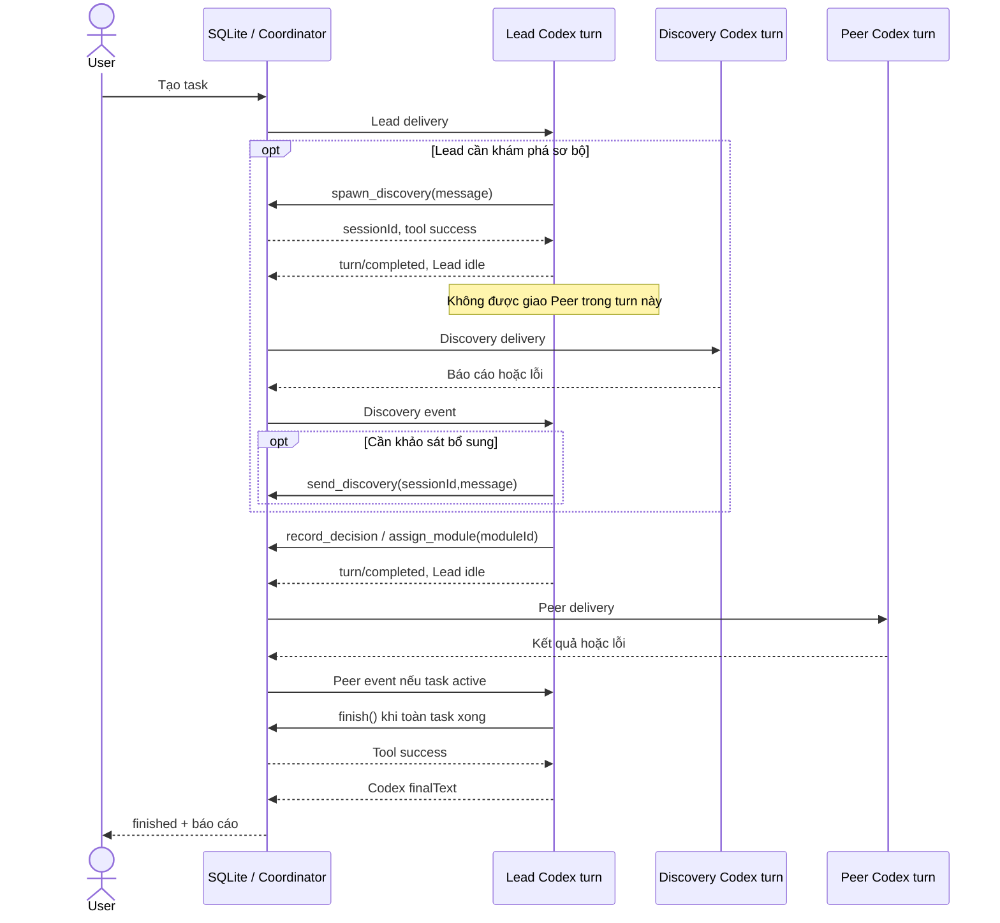

# Kiến trúc Event-driven Lead ↔ Discovery / Peer



## Trách nhiệm

- `apps/api/src/index.ts`: HTTP/SSE localhost; task mới luôn tạo Lead delivery.
- `apps/api/src/coordination-store.ts`: transaction SQLite, Task Brief do Lead sở hữu, kiểm tra contextRefs và snapshot Context Packet theo từng delivery, một Discovery session mỗi conversation, wakeLead event-driven, `finish` supersede queued deliveries.
- `apps/api/src/coordinator.ts`: Lead quyết định khi nào cần Discovery/Peer và chuyển Context Packet; Discovery chỉ khảo sát sơ bộ, Peer điều tra sâu/triển khai. Scheduler theo `store.on('change')`, tối đa một turn/session và bốn turn cùng lúc, không polling.
- `apps/api/src/codex-runtime.ts`: Codex app-server `thread/start`, `thread/resume`, `turn/start`; quy tắc vai trò (đọc từ `instructions/<role>.md`, tuỳ chọn; `apps/api/src/instructions.ts`) cộng dữ liệu phiên đi qua `developerInstructions` của `thread/start` và `thread/resume`, `turn/start` chỉ mang dữ liệu của lượt. Lead có dynamic tools, Discovery và Peer không có. Discovery dùng policy giống Peer, khác ở `thread/start.runtimeWorkspaceRoots`.
- `apps/web/src/components/ConversationFeed.tsx`, `AgentMonitor.tsx`, `ContextPacketView.tsx`: hiển thị nhiệm vụ, Context Packet đã gửi, Task Brief và session độc lập.

## Vòng đời và giới hạn

- Task: `active | finished`; session: `idle | running | interrupted`; delivery: `queued | running | completed | interrupted | superseded`.
- `spawn_discovery(message)` tạo Discovery session mới khi đã cấu hình và conversation chưa có Discovery. `send_discovery(sessionId,message)` tạo một giai đoạn khảo sát bổ sung vào đúng session của conversation sau khi lần trước đã hoàn thành; không dùng làm status poll.
- **Ranh giới giai đoạn bắt buộc:** mỗi Lead delivery có `routingPhase` bền trong SQLite. `Discovery` và `Peer/finish` không được kết hợp trong cùng Lead turn (bất kể thứ tự tool call); sau khi giao Discovery thành công, mọi routing tool tiếp theo của turn bị từ chối. Khi Discovery còn `queued/running`, Lead delivery mới không được bắt đầu và user follow-up chỉ được ghi message. Discovery báo cáo/lỗi sẽ đánh thức Lead trở lại; không polling.
- Cả Discovery và Peer phát event hoàn thành/lỗi về Lead. Khi có Lead delivery đang queued, `wakeLead()` không tạo delivery trùng. User message mới được lưu nhưng hoãn việc đánh thức Lead khi Discovery đang chạy.
- `finish()` tăng `generation`, bỏ qua queued work. Kết quả Discovery/Peer đến muộn vẫn được lưu nhưng không mở lại task hoặc wake Lead. User gửi message mới mới mở lại task.
- Sau restart, delivery đang chạy thành `interrupted`, không replay; Discovery interrupted tạo event cảnh báo cho Lead. Không đặt timeout cứng cho Codex turn; watchdog để giai đoạn sau.
- Lead xem báo cáo Discovery như **ngữ cảnh định hướng**, không xem là bằng chứng chuyên sâu. Khi cần xác minh logic, root cause hoặc triển khai, Lead giao Peer.

## Sandbox và nhiều module

- Lead: `workspace-write`, `writableRoots: [lead.cwd]`, mọi `CODEX_SECURITY_MODE`. Không đọc source hay chạy lệnh trong module là **quy tắc chỉ dẫn**, không phải sandbox; chấp nhận rủi ro Lead không tuân thủ.
- Discovery và Peer: cùng chính sách `CODEX_SECURITY_MODE`: mặc định `danger-full-access`, `approvalPolicy: never`; khi `sandbox`, `workspace-write`, `on-request`.
- Discovery có cwd riêng và `thread/start.runtimeWorkspaceRoots` gồm Discovery cwd và module paths. Khi `workspace-write`, `turn/start.sandboxPolicy.writableRoots` dùng cùng tập roots. Đây là cơ chế app-server tương ứng với mục tiêu `--add-dir`, **không có permission profile riêng**. Discovery được cấp quyền bởi runtime; instruction khám phá sơ bộ không thay thế OS sandbox.
- Những module được khai báo trong workspace config phải tin cậy. Discovery có thể truy cập nhiều module cùng lúc; không tự tạo Git worktree hoặc cơ chế xử lý conflict.

## Model / Effort

- `Snapshot.settings` lưu Lead/Discovery/Peer trong SQLite.
- Discovery và Lead đọc App Settings mỗi turn; giá trị trống dùng Codex default. Peer đóng băng settings khi spawn.
- `model/list` cấp model/effort catalog. Chỉ Lead có sáu dynamic tools `update_task_brief`, `record_decision`, `spawn_discovery`, `send_discovery`, `assign_module`, `finish`, với `callId` chống replay.
- Mỗi module có đúng một Peer trong conversation: `assign_module(moduleId)` tạo Peer ở lần đầu, các lần sau dùng lại Thread của Peer đó. Peer chỉ sửa module của mình (ràng buộc bằng `instructions/peer.md`, không bằng sandbox).
- Decision Log (`Conversation.decisions`) lưu append-only các quyết định Lead ghi bằng `record_decision`. Quyết định hiện hành của một `topic` là bản ghi cuối. Mỗi assignment mới của Peer chốt toàn bộ quyết định có `affects` chứa module (`decisions`), kể cả `[]`; snapshot này thay danh sách quyết định trước đó của Peer. Khi một topic không còn áp dụng cho module, assignment tiếp theo có danh sách không chứa topic đó. Không sửa packet đã queued/running. Discovery không nhận quyết định. App chỉ lưu và chuyển, không đánh giá quyết định.
- Không thêm parser/JSON protocol, outputSchema fallback, approval gate hoặc trạng thái task mới.

CI dùng fake Codex transport; cần E2E với Codex CLI/app-server phiên bản thực tế để xác minh `runtimeWorkspaceRoots`.

## Giao tiếp không dùng shared context

```text
Lead routeLeadTool()
  → update_task_brief(brief)
      → validate evidenceRefs hợp lệ và không dùng Discovery/Lead làm chứng cứ verified
      → Conversation.taskBrief trong SQLite
  → assign_module(message, expectedResult, contextRefs?, constraints?, previousContext?)
      → message: việc mới đủ rõ; có thể nhắc ràng buộc trực tiếp, không chép toàn lịch sử
      → assignmentPacket(Peer):
          peerCheckpoint   → luôn có assignmentId, moduleId, continues nếu có,
                             goal/acceptanceCriteria từ Brief và constraints do Lead viết
          decisions        → toàn bộ quyết định hiện hành áp dụng, kể cả []
          originalRequest  → khi session chưa có lượt completed nhận yêu cầu gốc
          sources          → contextRefs trừ: yêu cầu gốc, nguồn đã gửi,
                             báo cáo do chính session đó tạo
          previousContext  → metadata nguồn đã có và summary do Lead cung cấp
  → spawn_discovery/send_discovery(message, expectedResult, contextRefs?)
      → assignmentPacket(Discovery): original/Brief theo delta, nguồn được chọn
      → Message.contextPacket + Delivery trong một SQLite transaction
      → tool result báo Lead các nguồn không gửi lại
  → Coordinator: instructions (quy tắc vai trò) + prompt từ packet bất biến và việc mới
      → Codex thread/start|resume.developerInstructions + turn/start (Thread độc lập)
```

"Đã có trong Thread" chỉ tính delivery `completed` và báo cáo do chính session tạo. Nguồn từ delivery `interrupted/queued` chưa được xem là đã nhận. Peer checkpoint không dedup mục tiêu/tiêu chí/constraints/quyết định nên queued A → B → A vẫn giữ đúng từng snapshot. `previousContext` chỉ được trỏ nguồn trong contextRefs đã có trong Thread; kiểm tra nguồn/tóm tắt và tạo delivery cùng transaction. `constraints` không tự kế thừa từ assignment trước.

Prompt Peer mới gồm `ASSIGNMENT`, `MODULE`, `CONTINUES` khi có, `ORIGINAL_USER_REQUEST` khi cần, `CURRENT_GOAL`, `ACCEPTANCE_CRITERIA`, `CURRENT_CONSTRAINTS`, `ACTIVE_DECISIONS`, `PREVIOUS_CONTEXT`, `NEW_SUPPORTING_CONTEXT`, `WORK`, `EXPECTED_RESULT`. Mục tiêu dùng yêu cầu gốc khi chưa có Brief, tiêu chí rỗng được ghi rõ chưa được Lead cung cấp. Toàn bộ đánh giá `verified/preliminary/unknowns/nextDecision` không tự gửi lại cho Peer; Lead chọn nguồn và phần việc cần dùng. App không đánh giá nội dung hoặc tóm tắt báo cáo.

Packet cũ chưa có `peerCheckpoint` vẫn được render theo định dạng cũ; không lấy Brief/decisions mới để tái tạo packet cũ. Instructions Peer giải thích cả định dạng mới và packet cũ. Demo [hai lượt](PEER_PROMPT_DEMO.md) được sinh từ JSON-RPC request qua app-server giả; regression đối chiếu nguyên văn demo với payload chuẩn hóa UUID/timestamp. Đây không phải Codex E2E thật.

Lead nhận `NEW_EVENTS` kèm message ID để chọn `contextRefs`; các event trước nằm trong chính Codex Thread. Prompt mỗi lượt của Lead chỉ gồm `PEER_SESSIONS`, `DISCOVERY_SESSIONS`, `NEW_EVENTS`; quy tắc, `MODULES`, `DISCOVERY_ENABLED` nằm trong `developerInstructions` và được làm mới ở mỗi `thread/resume`. Task Brief không gửi lại cho Lead vì Lead là bên duy nhất ghi nó. UI mở Context Packet đã lưu để xác minh phần thực tế đã chuyển giao. Nguồn `discovery-preliminary` luôn là nhận định sơ bộ; App không đánh giá chất lượng nội dung Peer hay chứng thực kết luận Lead.

Chưa kiểm chứng với Codex thật: `developerInstructions` trên `thread/resume` có được áp dụng cho Thread cũ hay không (schema app-server 0.166.0 có field này; CI chỉ dùng fake transport).

## Event inbox không phát lại lịch sử App

Mỗi Lead delivery có `eventMessageIds`, append khi queued và đóng băng khi running. `leadInputs(delivery.id)` chỉ trả các event đến lượt đó; `NEW_EVENTS` không phải toàn bộ App chat. `postUser` trong lúc Discovery chạy vẫn đưa event vào queued Lead delivery; `startDelivery()` chặn Lead đến khi Discovery hoàn tất, lúc đó kết quả được append vào cùng batch. `codexTurnId` đánh dấu `turn/start` đã được xác nhận, không chứng minh xử lý xong; running delivery không tự replay sau restart.
