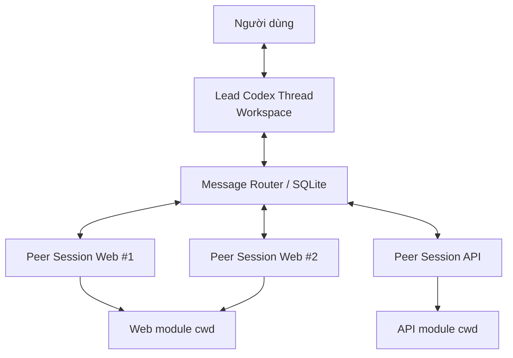
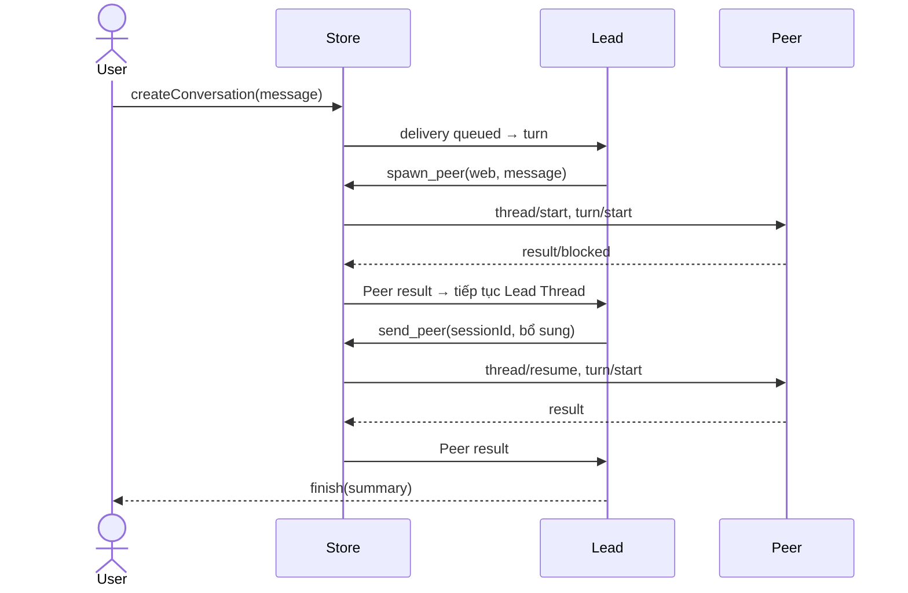

# Kiến trúc Agent Communication Runtime

Không có Peer-to-Peer, các Peer không nhìn thấy danh sách session khác trừ thông tin Lead chủ động chia sẻ.

## Trách nhiệm

- `apps/api/src/index.ts`: HTTP API, localhost-only, SSE, bootstrap.
- `apps/api/src/coordination-store.ts`: SQLite snapshot transaction cho Conversation/Session/Message/Delivery; khôi phục sau crash.
- `apps/api/src/coordinator.ts`: hàng đợi tin nhắn, giữ tối đa bốn Codex turns đồng thời (giới hạn tài nguyên, không phải quality gate); đảm bảo tối đa một turn đang chạy trên cùng session.
- `apps/api/src/codex-runtime.ts`: transport gọi `thread/start`, `thread/resume`, `turn/start` và nhận JSON-RPC notifications.
- `apps/api/src/lead-protocol.ts`: parse câu trả lời Lead thành reply và các action định tuyến. Không kiểm tra nội dung file hoặc đánh giá chất lượng.
- `apps/web/src/main.tsx`: hội thoại người dùng với Lead, danh sách Peer sessions và transcript chỉ đọc.

## Luồng

## Trạng thái kỹ thuật

`Conversation`: `active | finished`. `AgentSession`: `idle | running | interrupted`. `Delivery`: `queued | running | completed | interrupted`.

Phân biệt trạng thái **Delivery**, không áp dụng `accept/rework/pass` do Backend đánh giá. Lead có thể tiếp tục các Peer bao nhiêu lần cũng được.

`completeLead()` commit atomically kết quả Lead và các deliveries mới. `completePeer()` commit kết quả Peer và message tới Lead. Chỉ Lead được tạo/gửi Peer messages. `Coordinator` thực thi các delivery đang `queued` và không chạy song song hai turn cùng session. Multiple Peer sessions trong cùng module **có thể** chạy đồng thời, có nguy cơ cùng ghi file.

Sau crash, các delivery `running` chuyển sang `interrupted` và **không replay**; session lưu `threadId` để các lượt tiếp theo có thể resume. Old workflow DB không được import sang `coordination.sqlite`.

## Codex boundary

Lead `cwd=lead.cwd`, sandbox read-only. Peer `cwd=modules[].path`, mặc định YOLO (`danger-full-access`); App không dùng worktree. Hướng dẫn mô hình Peer không gửi message trực tiếp đến Peer khác là **ràng buộc routing**, không phải OS security boundary. Reviewer chỉ có thể được thêm sau này như một Agent được Lead chủ động gọi; không gate bắt buộc.

Các kết quả Codex được hiển thị trung thực, không giả test pass; End-to-end với Codex thật phải xác minh trên máy cài Codex.
