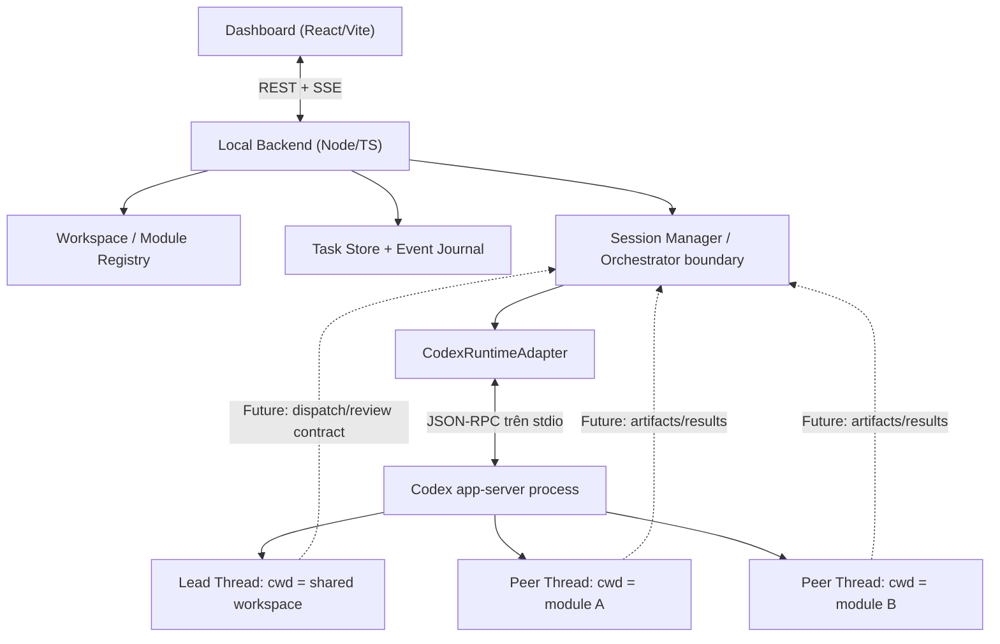
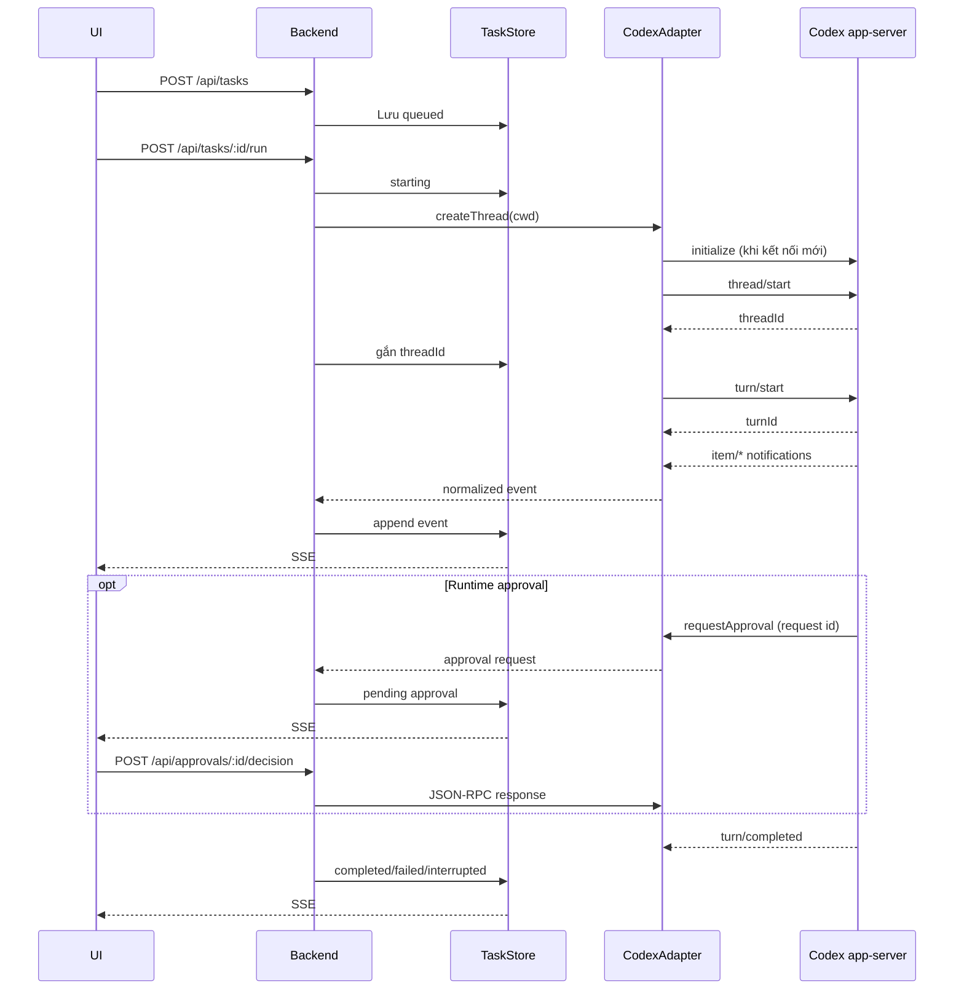

# Architecture — Lead/Peer Personal Workspace

## Sơ đồ tổng thể



## Trách nhiệm và hướng dữ liệu

| Thành phần | Sở hữu | Không sở hữu |
|---|---|---|
| Dashboard | Tạo task, chạy/dừng, xem events, duyệt runtime approval | LLM token, shell execution |
| API | Validation, CORS localhost, endpoints, SSE | Nghiệp vụ suy luận của Lead |
| WorkspaceRegistry | Đường dẫn tuyệt đối được allowlist trong config | Source code module |
| TaskStore | Task status, threadId/turnId, events, pending approvals | Context chi tiết trong Codex |
| SessionManager | Chuyển Task đến đúng `cwd`, lifecycle, interrupt | Tự suy luận kế hoạch |
| CodexAdapter | Spawn app-server, JSONL, RPC request/notification, callback | Task orchestration |
| Codex app-server | Agent loop, tool execution, conversation, runtime approval | Task/Peer workflow của ứng dụng |

## Đơn vị dữ liệu

- **Workspace**: thư mục chung chạy Lead, có `cwd` từ config.
- **Module**: ID ổn định + đường dẫn thật, đăng ký thủ công; có thể nằm ngoài repo điều khiển.
- **Agent**: role `lead` hoặc `peer`, instructions thuộc ứng dụng; một Agent không đồng nghĩa một OS process.
- **Task**: công việc nghiệp vụ, có `agentRole`, `moduleId`, `status`, `prompt`, `threadId`, `turnId`.
- **Session**: mapping Thread/Turn của Codex gắn với Task. Ban đầu một Task tạo Thread mới.
- **Event**: sự kiện đã normalize có `taskId` và payload để audit/UI.
- **Approval**: yêu cầu RPC từ app-server (command/file change); khác với Business Approval của Lead trong roadmap.

## Chuỗi xử lý foundation



## Task lifecycle

```text
queued → starting → running → completed
                   ↘ waiting_runtime_approval → running
                   ↘ failed
                   ↘ interrupted
starting → failed
```

`turn/completed` **phải** kiểm tra `turn.status`. `failed`/`interrupted` không được đánh dấu thành công. Mọi trạng thái lâu dài thuộc Backend, không suy ra từ animation/UI.

## Ranh giới bảo mật

1. Chỉ bind API vào `127.0.0.1` trong MVP; chưa có auth, không đặt public.
2. `cwd` đến từ config allowlist, không nhận từ request; dùng `realpath` để kiểm tra tồn tại.
3. Sử dụng `approvalPolicy: onRequest`, `sandboxPolicy: workspaceWrite` với `writableRoots` chỉ gồm workspace hoặc module tương ứng. Không bật `dangerFullAccess`, không tự accept mọi approval.
4. Bản foundation chỉ xử lý approval command/file-change thông dụng. Các kiểu server request khác được từ chối an toàn, không tự duyệt.
5. Không commit `config/workspace.local.json`, `.data/`, credentials hay log cá nhân.
6. Đặt `cwd` và sandbox policy **không thay thế** kiểm soát quyền host; trước khi bật auto-dispatch phải bổ sung worktree isolation, kiểm tra symlink và quyền công cụ.

## Kế hoạch tiếp theo

- Thêm `LeadPlan` schema, dispatch queue, dependency, kết quả có cấu trúc.
- Peer chạy trong module hoặc Git worktree được cấp riêng, ghi artifact và test evidence.
- Lead review/return/retry dựa trên diff + test evidence; Business Approval có state riêng.
- Recovery: đối chiếu thread state khi restart thay vì retry mù để tránh chạy trùng.
- Session history, observability, diff viewer và live control hoàn chỉnh.

## Tài liệu giao thức

https://developers.openai.com/codex/app-server
