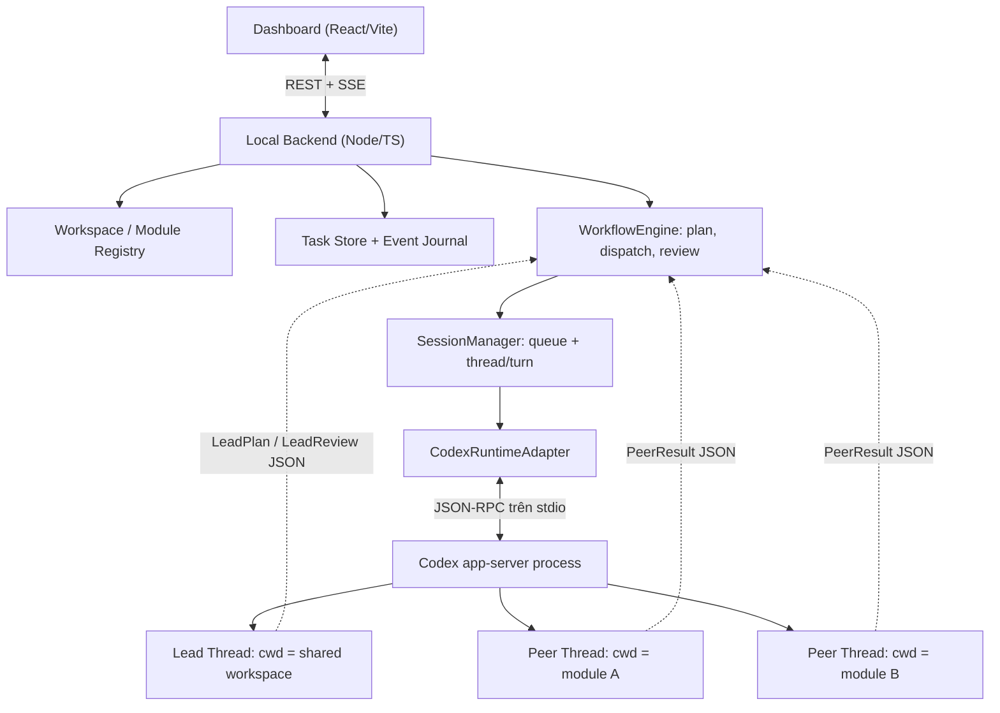
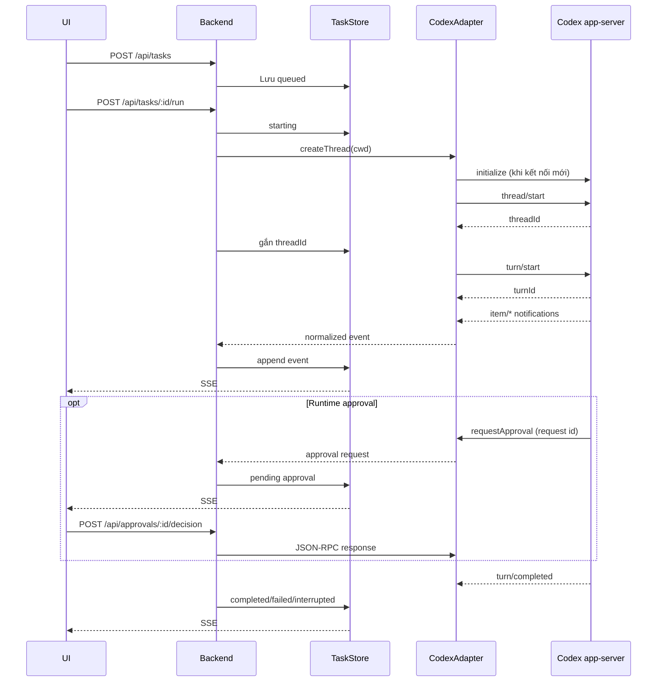

# Architecture — Lead/Peer Personal Workspace

## Sơ đồ tổng thể



## Trách nhiệm và hướng dữ liệu

| Thành phần | Sở hữu | Không sở hữu |
|---|---|---|
| Dashboard | Tạo task, chạy/dừng, xem events, duyệt runtime approval | LLM token, shell execution |
| API | Validation, CORS localhost, endpoints, SSE | Nghiệp vụ suy luận của Lead |
| WorkspaceRegistry | Đường dẫn tuyệt đối được allowlist trong config | Source code module |
| TaskStore | Task status, threadId/turnId, events, pending approvals | Context chi tiết trong Codex |
| SessionManager | Queue, giới hạn concurrency, chuyển Task đến đúng `cwd`, lifecycle, interrupt | Review và dispatch plan |
| WorkflowEngine | LeadPlan validation, DAG scheduler, PeerResult handoff, LeadReview, Business Approval | LLM inference và shell execution |
| CodexAdapter | Spawn app-server, JSONL, RPC request/notification, callback | Task orchestration |
| Codex app-server | Agent loop, tool execution, conversation, runtime approval | Task/Peer workflow của ứng dụng |

## Đơn vị dữ liệu

- **Workspace**: thư mục chung chạy Lead, có `cwd` từ config.
- **Module**: ID ổn định + đường dẫn thật, đăng ký thủ công; có thể nằm ngoài repo điều khiển.
- **Agent**: role `lead` hoặc `peer`, instructions thuộc ứng dụng; một Agent không đồng nghĩa một OS process.
- **Task**: công việc nghiệp vụ, có `agentRole`, `moduleId`, `status`, `prompt`, `threadId`, `turnId`.
- **Session**: mapping Thread/Turn của Codex gắn với Task. Ban đầu một Task tạo Thread mới.
- **Event**: sự kiện đã normalize có `taskId` và payload để audit/UI.
- **Runtime Approval**: yêu cầu RPC từ app-server (command/file change).
- **Business Approval**: quyết định của người dùng sau khi Lead chấp nhận toàn bộ Peer output.
- **WorkflowRun**: kế hoạch Lead, danh sách PeerWork/attempt, reviewCount và trạng thái review/approval. Dữ liệu lưu bởi Backend.

## Chuỗi xử lý foundation



## Task lifecycle

```text
queued → starting → running → completed
                   ↘ waiting_runtime_approval → running
                   ↘ failed
                   ↘ interrupted
starting → failed
```

`turn/completed` **phải** kiểm tra `turn.status`. `failed`/`interrupted` không được đánh dấu thành công. Mọi trạng thái lâu dài thuộc Backend, không suy ra từ animation/UI.

## Ranh giới bảo mật

1. Chỉ bind API vào `127.0.0.1` trong MVP; chưa có auth, không đặt public.
2. `cwd` đến từ config allowlist, không nhận từ request; dùng `realpath` để kiểm tra tồn tại.
3. **YOLO mode (chủ động chọn cho local):** `approvalPolicy: "never"`, `sandbox: "danger-full-access"` tại `thread/start` và `sandboxPolicy: { "type": "dangerFullAccess" }` tại `turn/start`. Codex chạy **không sandbox và không yêu cầu runtime approval**. Chỉ chạy với workspace tin cậy trên máy cá nhân.
4. Runtime Approval UI vẫn có mã xử lý cũ nhưng với YOLO mode sẽ không nhận approval thông thường; **Business Approval** cuối Workflow vẫn là bước duyệt thủ công. Không đồng nhất hai khái niệm này.
5. Không commit `config/workspace.local.json`, `.data/`, credentials hay log cá nhân.
6. Đặt `cwd` và sandbox policy **không thay thế** kiểm soát quyền host. P1 chỉ giới hạn một Peer cùng lúc/module, **không cách ly Git working tree**; phải dùng workspace tin cậy, lưu thay đổi trước khi chạy. Worktree isolation và kiểm tra symlink là yêu cầu P2 trước khi dùng rộng rãi.

## Kế hoạch tiếp theo

- P1: đã thêm `LeadPlan`, DAG validation, dispatch theo module, `PeerResult`, `LeadReview` với số vòng rework hữu hạn và Business Approval.
- P1: `PeerEvidence` thu thập Git status/diff so với `HEAD` và command events; không thay thế test verification độc lập.
- P2: thêm Git worktree, artifact store, kiểm chứng diff/test evidence và resume thread an toàn.
- Recovery: đối chiếu thread state khi restart thay vì retry mù để tránh chạy trùng.
- Session history, observability, diff viewer và live control hoàn chỉnh.

## Tài liệu giao thức

https://developers.openai.com/codex/app-server

## Luồng P1

Đọc `docs/WORKFLOW_P1.md` để xem contracts, dependency, các nhánh review và API. Các Agent được tạo thành **Task có Thread riêng**; Lead review nhận context từ JSON plan và PeerResult. P1 chưa tái sử dụng một Codex Thread duy nhất cho mọi review turn.

## Codex app-server YOLO wire format

Cấu hình hiện tại tương đương `codex --yolo`:

- `thread/start`: `{ "approvalPolicy": "never", "sandbox": "danger-full-access" }`.
- `turn/start`: `{ "approvalPolicy": "never", "sandboxPolicy": { "type": "dangerFullAccess" } }`.
- `sandbox` là enum kiểu **kebab-case**, `sandboxPolicy.type` là tagged enum **camelCase**. `workspaceWrite` ở `thread/start` và `workspace-write` ở `sandboxPolicy.type` đều sai giao thức.
- Regression test kiểm tra cả 2 RPC request trên fake app-server.

**Rủi ro:** Chế độ này bỏ hàng rào bảo vệ file/network; Codex có thể thao tác cả bên ngoài module theo quyền user chạy Backend, kể cả thay đổi/xóa file hoặc gọi lệnh không cần duyệt. `cwd`, instructions và module lock **không tạo bảo mật hoặc filesystem isolation**. Chỉ dùng với dữ liệu/Agent đáng tin, sao lưu hoặc commit code trước khi chạy, không mở HTTP server ra mạng.

## Activity Timeline (P1 UX)

- `TaskStore.event` nhận notifications từ Codex, dùng `projectActivity` để tạo timeline có ý nghĩa. Các `item/agentMessage/delta` của cùng `itemId` gom lại thành một ActivityEntry, không lưu raw event cho từng token.
- Trạng thái Task, `turn/started`, `turn/completed`, command/file/tool lifecycle và Workflow events được diễn giải riêng (không phải nguyên tên phương thức JSON-RPC).
- `ActivityEntry` được lưu trong `.data/state.json`. Nếu có event journal cũ mà chưa có `activities`, backend reconstruct một lần khi khởi động. Tối đa 500 ActivityEntries, API trả 300 gần nhất.
- Streaming delta có flush/publish 250ms để hạn chế I/O và refresh UI; các event không phải delta vẫn được ghi ngay.
- UI lọc Lead/Peer/Workflow và Task, hiển thị trạng thái, mốc thời gian, tóm tắt structured result. **Raw JSON** còn trong tab kỹ thuật để debug (ngoại trừ streaming fragment đã được gộp).
- Đây là *projection* phục vụ trải nghiệm, không thay thế `Task` / `WorkflowRun` state machine hay nhật ký audit đầy đủ. Việc lọc bỏ raw delta cần được hiểu khi debug.
