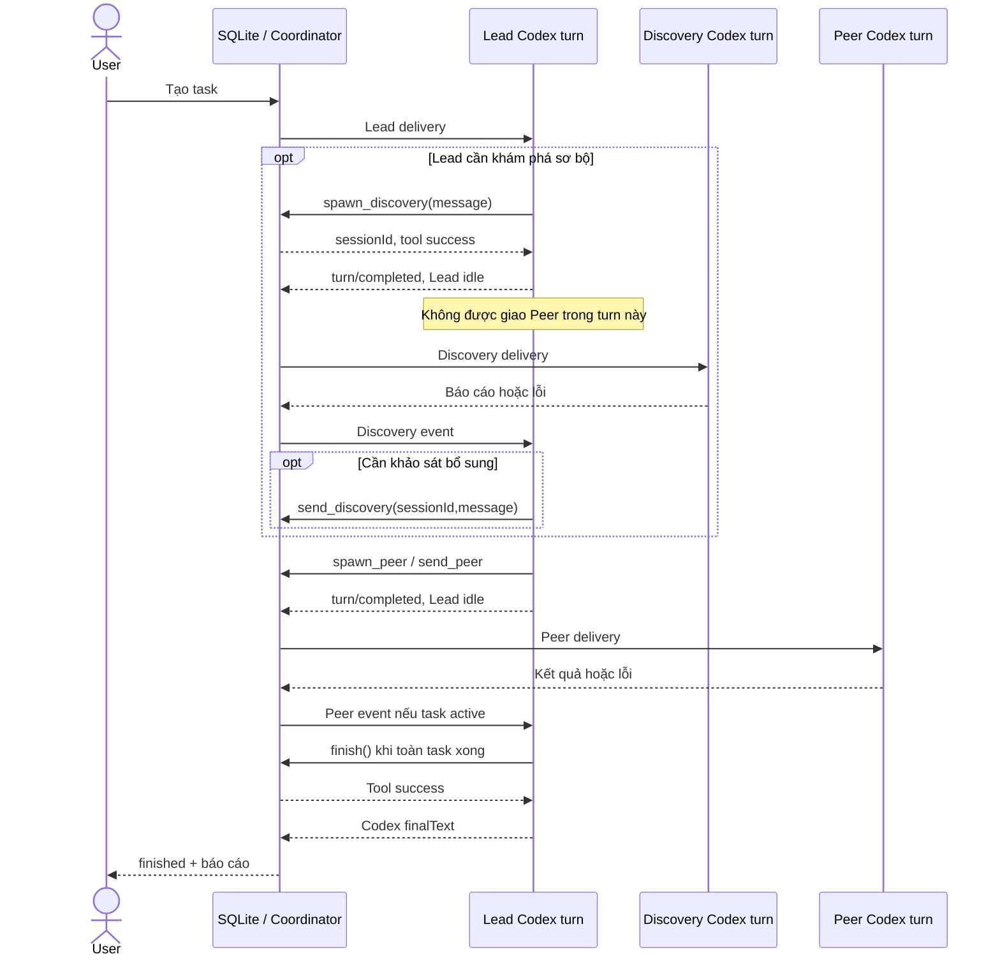

# Kiến trúc Event-driven Lead ↔ Discovery / Peer

## Trách nhiệm

- `apps/api/src/index.ts`: HTTP/SSE localhost; task mới luôn tạo Lead delivery.
- `apps/api/src/coordination-store.ts`: transaction SQLite, Lead routing idempotent, một Discovery session mỗi conversation, message Lead ↔ Discovery, wakeLead event-driven, `finish` supersede queued deliveries.
- `apps/api/src/coordinator.ts`: Lead quyết định khi nào gọi Discovery; Discovery chỉ khám phá sơ bộ theo instruction, Peer điều tra sâu và triển khai. Scheduler theo `store.on('change')`, tối đa một turn/session và bốn turn cùng lúc, không polling.
- `apps/api/src/codex-runtime.ts`: Codex app-server `thread/start`, `thread/resume`, `turn/start`; Lead có dynamic tools, Discovery và Peer không có. Discovery dùng policy giống Peer, khác ở `thread/start.runtimeWorkspaceRoots`.
- `apps/web/src/components/ConversationFeed.tsx`, `AgentMonitor.tsx`: hiển thị luồng giao việc, báo cáo Discovery và trạng thái session độc lập.

## Vòng đời và giới hạn

- Task: `active | finished`; session: `idle | running | interrupted`; delivery: `queued | running | completed | interrupted | superseded`.
- `spawn_discovery(message)` tạo Discovery session mới khi đã cấu hình và conversation chưa có Discovery. `send_discovery(sessionId,message)` tạo một giai đoạn khảo sát bổ sung vào đúng session của conversation sau khi lần trước đã hoàn thành; không dùng làm status poll.
- **Ranh giới giai đoạn bắt buộc:** mỗi Lead delivery có `routingPhase` bền trong SQLite. `Discovery` và `Peer/finish` không được kết hợp trong cùng Lead turn (bất kể thứ tự tool call); sau khi giao Discovery thành công, mọi routing tool tiếp theo của turn bị từ chối. Khi Discovery còn `queued/running`, Lead delivery mới không được bắt đầu và user follow-up chỉ được ghi message. Discovery báo cáo/lỗi sẽ đánh thức Lead trở lại; không polling.
- Cả Discovery và Peer phát event hoàn thành/lỗi về Lead. Khi có Lead delivery đang queued, `wakeLead()` không tạo delivery trùng. User message mới được lưu nhưng hoãn việc đánh thức Lead khi Discovery đang chạy.
- `finish()` tăng `generation`, bỏ qua queued work. Kết quả Discovery/Peer đến muộn vẫn được lưu nhưng không mở lại task hoặc wake Lead. User gửi message mới mới mở lại task.
- Sau restart, delivery đang chạy thành `interrupted`, không replay; Discovery interrupted tạo event cảnh báo cho Lead. Không đặt timeout cứng cho Codex turn; watchdog để giai đoạn sau.
- Lead xem báo cáo Discovery như **ngữ cảnh định hướng**, không xem là bằng chứng chuyên sâu. Khi cần xác minh logic, root cause hoặc triển khai, Lead giao Peer.

## Sandbox và nhiều module

- Lead: `read-only` như trước.
- Discovery và Peer: cùng chính sách `CODEX_SECURITY_MODE`: mặc định `danger-full-access`, `approvalPolicy: never`; khi `sandbox`, `workspace-write`, `on-request`.
- Discovery có cwd riêng và `thread/start.runtimeWorkspaceRoots` gồm Discovery cwd và module paths. Khi `workspace-write`, `turn/start.sandboxPolicy.writableRoots` dùng cùng tập roots. Đây là cơ chế app-server tương ứng với mục tiêu `--add-dir`, **không có permission profile riêng**. Discovery được cấp quyền bởi runtime; instruction khám phá sơ bộ không thay thế OS sandbox.
- Những module được khai báo trong workspace config phải tin cậy. Discovery có thể truy cập nhiều module cùng lúc; không tự tạo Git worktree hoặc cơ chế xử lý conflict.

## Model / Effort

- `Snapshot.settings` lưu Lead/Discovery/Peer trong SQLite, bổ sung `discovery: {}` khi mở snapshot cũ.
- Discovery lấy `App Settings Discovery → discovery workspace config → Codex default` cho từng trường tại thời điểm bắt đầu turn. Lead đọc defaults mỗi turn; Peer đóng băng settings lúc spawn.
- `model/list` cấp model/effort catalog. Chỉ Lead có năm dynamic tools `spawn_discovery`, `send_discovery`, `spawn_peer`, `send_peer`, `finish`, với `callId` chống replay.
- Không thêm parser/JSON protocol, outputSchema fallback, approval gate hoặc trạng thái task mới.

CI dùng fake Codex transport; cần E2E với Codex CLI/app-server phiên bản thực tế để xác minh `runtimeWorkspaceRoots`.
