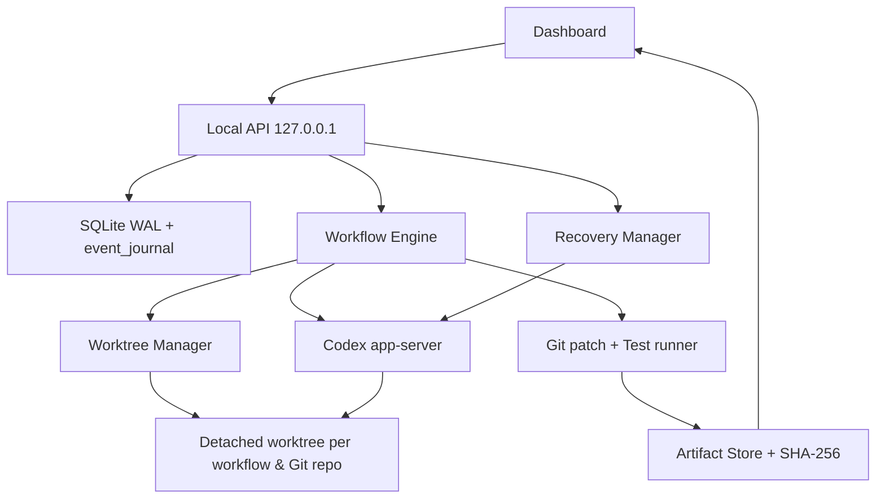

# P2 — Isolation, SQLite, Recovery và Artifacts

## Mục tiêu

Các Peer không còn sửa source repository trực tiếp. Backend giữ lịch sử Task/Workflow bền vững, thu bằng chứng test độc lập và cho phép đối chiếu Codex Thread sau restart mà không phát lại tool commands.

## Data flow



## Git isolation và merge policy

- Module phải nằm trong Git repo có ít nhất một commit. Khi tạo worktree lần đầu, source repo phải sạch theo `git status --porcelain --untracked-files=all`. Có file chưa commit thì Backend **từ chối chạy** thay vì bỏ qua thay đổi của người dùng.
- Worktree được tạo dưới `APP_DATA_DIR/worktrees/<workflowId>/<repoHash>/` bằng `git worktree add --detach`. Hai module cùng Git repo/chung workflow dùng chung worktree. Hai workflow khác nhau có worktree khác nhau.
- SessionManager chỉ cho tối đa một Peer ghi cùng Git repo đồng thời; tránh xung đột trong worktree chung.
- Peer nhận `cwd` trỏ đến module **trong worktree**, không phải source repo. Lead nhận `modulePath` thực tế của các Peer trong worktree để review.
- `git add -A -- <modulePath>` và `git diff --cached --binary HEAD -- <modulePath>` chạy **chỉ trên worktree**. Patch kể cả file untracked, được lưu thành artifact hash SHA-256, cho xem/tải trong Dashboard.
- **Merge policy: review-only.** Backend không tự commit, push, apply hoặc merge vào source. Sau Business Approval, người dùng có thể tải patch và tự kiểm tra trên source sạch:

```bash
git -C /absolute/path/to/source-repo apply --check /path/to/downloaded.patch
git -C /absolute/path/to/source-repo apply /path/to/downloaded.patch
```

Nếu một workflow dùng nhiều module chung repository, các patch module phải áp dụng theo thứ tự dependency. Worktree không được tự xóa khi restart để giữ bằng chứng và sửa đổi chưa xuất.

**Giới hạn:** Git worktree là isolation của working tree, không phải sandbox bảo mật của hệ điều hành. Trong YOLO mode, Codex vẫn có thể truy cập/chỉnh sửa file ngoài worktree theo quyền tài khoản đang chạy.

## SQLite và Event Journal

- `APP_DATA_DIR/state.sqlite` là trạng thái chính thức, dùng SQLite WAL và `synchronous=FULL`.
- `snapshots` giữ Task/Workflow/Approval/Activity; `event_journal` append-only giữ các sự kiện không phải token delta với `seq` tăng dần.
- Lần đầu chạy P2, Backend nhập dữ liệu từ P1 `state.json` vào SQLite. Sau đó SQLite luôn có độ ưu tiên cao hơn. `state.json` vẫn tồn tại dưới dạng bản mirror tương thích P1, không phải nguồn quyết định.
- `GET /api/journal?after=0&limit=100`: đọc journal theo cursor, tránh mất các event cũ khi Activity Timeline có giới hạn.
- `SingleInstanceLock` hạn chế hai backend cùng sử dụng `APP_DATA_DIR` để tránh dispatch song song từ hai tiến trình. Tắt backend bình thường sẽ giải phóng lock.

Node.js 22 hỗ trợ `node:sqlite` nhưng API đang ở trạng thái experimental trên dòng Node 22. Cần chạy CI/runtime smoke test với Node 22 như project đã khai báo.

## Recovery: không thực thi trùng

Khi Backend restart:
1. Các Task đang chạy chuyển thành `interrupted`, các Workflow đang xử lý chuyển thành `interrupted`, không tự chạy lại Peer.
2. Backend đọc `thread/read`, `thread/turns/list` từ Codex cho các Task có `threadId` và `turnId` đã lưu.
3. `reconciliation.status` là `active`, `completed` (Turn đã terminal) hoặc `unknown`. Đây là kết quả đối chiếu, **không tự gán Workflow completed** khi chưa có output đúng.
4. Nút **Reconcile** cho phép người dùng đọc lại tình trạng. Chỉ khi Turn cũ đã terminal, người dùng mới được tạo một follow-up prompt mới. Backend sử dụng `thread/resume` rồi `turn/start` **với prompt mới**, không phát lại prompt cũ.
5. Follow-up được quản lý như Task riêng; không tự làm thay đổi kết quả review của Workflow bị interrupted. Các trường hợp không thể xác minh Turn cũ phải được xử lý thủ công.

## Independent test evidence

- Nếu muốn Backend chủ động chạy test sau Peer, cấu hình `modules[].testCommand` dưới dạng argv JSON, ví dụ `["npm", "test"]`. Không cần cài runner mới hoặc truy xuất `test.command` do Agent tự báo.
- Backend chạy argv bằng `execFile`, `cwd` là worktree module, timeout 60 giây, giới hạn output. Ghi trạng thái `passed | failed | not_configured`, exit code và output vào `PeerEvidence.verifiedTest`.
- Lead không được chấp nhận Peer nếu independent runner đã fail. Final reviewer cũng không được PASS nếu có verified test failed.
- Test runner có thể chạy package scripts từ repo, **vẫn có side effects** theo quyền OS user. Chỉ dùng test command của repo tin cậy, không cho người dùng truyền shell string qua API. Không có command được cấu hình đồng nghĩa `not_configured`, **không phải test passed**.

## Artifact Store & Diff Viewer

- Patch và test output lưu ở `APP_DATA_DIR/artifacts/<UUID>`; `index.json` ghi metadata và SHA-256.
- `GET /api/artifacts/:id`: đọc artifact theo UUID cố định, kiểm tra SHA-256 trước khi trả; không nhận file path từ client. Dashboard có preview diff và tải patch.
- Artifact giới hạn 8 MiB, preview UI giới hạn 100 kB. Nếu patch quá lớn, workflow sẽ fail rõ ràng thay vì âm thầm bỏ nội dung.

## Permission policy

`CODEX_SECURITY_MODE`:

- Không đặt (mặc định): `yolo` như lựa chọn ở P1, `approvalPolicy=never`, `danger-full-access`. **Không có sandbox**.
- `CODEX_SECURITY_MODE=sandbox`: `approvalPolicy=on-request`, `sandbox=workspace-write`, `sandboxPolicy.type=workspaceWrite`, writableRoots chỉ chứa worktree `cwd` và `networkAccess=false`.

HTTP API vẫn chỉ bind `127.0.0.1`. Backend chỉ chạy Git/verification với argv cố định hoặc module config; không nhận shell command từ Dashboard. **MCP tools được cấu hình ở Codex client bên ngoài hệ thống chưa bị chặn ở tầng API này**, nên để đạt một permission boundary thực sự, phải quản trị MCP config và quyền OS khi chạy Codex; YOLO không thể được coi là an toàn chỉ nhờ app-server routing.

## Trạng thái kiểm thử

Mock/fixture tests kiểm tra detached worktree, dirty repo, patch export, SQLite migration/journal, artifact hashes, recovery và session lifecycle. Live Codex app-server E2E với Git repos thật trên máy của người dùng vẫn cần chạy; CI không tự chứng minh quyền filesystem/MCP ở máy cá nhân.
