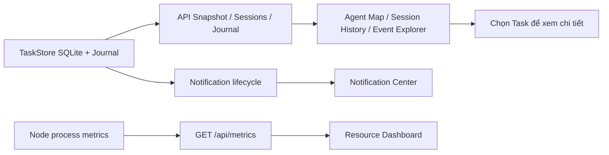

# P3 — Experience & Observability

## Phạm vi

P3 cải thiện khả năng quan sát và điều khiển giao diện, **không thay đổi quyền điều phối**: Lead ra quyết định, Peer thực hiện, Final Reviewer độc lập ở fresh session, Human duyệt nghiệp vụ khi cần. Định dạng dữ liệu mở rộng theo hướng tương thích P1/P2; notifications cũ không tồn tại thì mặc định mảng rỗng.

## Bản đồ Agent 2.5D

`AgentMap` hiển thị ba khu vực: Lead, Peers theo danh sách module trong config, và Final Reviewer. Node đọc các Task thực tế của Workflow đang chọn. Node ưu tiên Task đang `starting/running/waiting_runtime_approval`, sau đó mới đến Task gần nhất; không có Task thì hiển thị `idle`. Click vào node chọn Task để xem lịch sử và Activity Timeline. CSS hiển thị nền isometric và tile nổi; không tải hình ảnh bên ngoài.

## Session History

`GET /api/sessions?limit=20&role=peer&status=completed&workflowId=...&cursor=<lastTaskId>`

- Lịch sử đọc từ các Task bền vững, theo thứ tự mới nhất trước. `cursor` là ID của mục cuối trang trước, không dùng offset nên việc thêm Task mới ít làm lệch phân trang.
- Bộ lọc role, status và workflow áp dụng ở Backend; `limit` trong 1–100, cursor không hợp lệ bị từ chối.
- Session gồm Task ID, Codex threadId/turnId khi có, title, role, module, timestamps và duration. `durationMs` chỉ có khi Task mới có `startedAt` và `finishedAt`; không tự đoán duration của Task legacy.
- Dữ liệu session không đồng nghĩa một OS process riêng; các Task có thể chia sẻ app-server process.

## Event filters và Journal Explorer

`ActivityPanel` hỗ trợ role (bao gồm Reviewer), trạng thái, từ khóa và thời gian đối với các ActivityEntry có sẵn trong snapshot. Để tra cứu lịch sử bền vững hơn dùng:

`GET /api/journal/history?before=<seq>&limit=30&taskId=...&kind=workflow/&search=...`

- `before` là cursor tăng dần trong DB nhưng kết quả trả theo `seq DESC`, mới nhất trước.
- `kind` là prefix literal, ký tự wildcard SQL được escape; `taskId` so khớp chính xác, `search` tìm trong JSON `data` qua SQLite.
- Query được parameterize; giới hạn 100 kết quả/lần, `search` tối đa 120 ký tự.
- Không ghi lại raw token fragments đã bị loại bỏ trong P1/P2; journal chỉ chứa những event Backend đã lưu.

## Notifications

Thông báo được tạo ở **chuyển trạng thái**, không tạo từ polling, cho các Task `failed/interrupted` và Workflow `waiting_business_approval`, `waiting_manual_verification`, `blocked`, `failed`, `interrupted`. Cùng một workflow chỉ có thêm thông báo khi trạng thái chuyển sang trạng thái mới; không lặp khi chỉ thay đổi dữ liệu phụ. Cơ chế lưu trong SQLite snapshot, giới hạn 500 notification gần nhất.

- `GET /api/notifications`: đọc danh sách mới nhất trước.
- `POST /api/notifications/:id/read`: gắn `readAt`, gọi lại không sinh tác động mới.
- Thông báo là **in-app**, không có push/email/browser notification và không tự xác nhận Human Verification hay Business Approval.
- Sau restart, các trạng thái interrupted có thể xuất hiện lại, nhưng P3 không tự replay Codex commands.

## Resource monitoring

`GET /api/metrics` trả `observedAt`, bộ nhớ RSS/heap, tổng CPU user/system seconds và uptime của **Node Backend**, cùng số Task active/queued, Workflow đang chạy/chờ Human và thông báo chưa đọc. Frontend polling mỗi 8 giây; errors được hiển thị thay vì giả sử metrics vẫn mới. Không đọc CPU/RAM của từng Codex Agent, không theo dõi GPU hoặc token usage vì các dữ liệu đó chưa có nguồn đo đáng tin cậy.

## Runtime Adapter Claude Code

Roadmap ghi *nếu cần*. Trong phạm vi P3 hiện tại, runtime duy nhất là Codex CLI subscription đã đăng nhập. Chưa có yêu cầu sử dụng Claude Code, nên không bổ sung adapter hoặc phát sinh authentication/API keys. Khi cần triển khai đa provider, phải có hợp đồng capability/event/lifecycle riêng và các test fake app-server/CLI tương ứng; không ép dữ liệu của Claude vào Codex JSON-RPC schema.

## Kiểm thử và giới hạn

Tests bao gồm: notification lifecycle/read/restart, session cursor và filters, journal prefix/SQL wildcard/seq cursor, metrics, AgentMap projection và Activity role. CI chạy typecheck, API/Web unit tests, Web build. **Chưa có live E2E trên máy người dùng hoặc kiểm thử trình duyệt trực quan tự động.** Hệ thống vẫn chỉ bind localhost và không tạo ranh giới OS-level mới từ UI.

## Trạng thái sau restart

Khi Backend restart, `TaskStore` chuyển Task/Workflow đang chạy dở sang `interrupted` và tạo notification tương ứng trong cùng SQLite snapshot. Không tự chạy lại Codex Turn. `startedAt` của các Task legacy có thể vắng mặt; nếu không đủ timestamps thì Session History không hiển thị thời lượng giả.

## Workflow Failure Reconciliation — Git source chưa sạch

Khi `SessionManager.prepare()` thất bại vì `WorktreeManager.ensure()` phát hiện Git repository có thay đổi chưa commit, `WorkflowEngine.executePeer()` chuyển **Task vừa tạo** từ `queued` sang `failed`, ghi `error`, đồng thời đặt PeerWork thành `failed`. Workflow chuyển `failed`; các Peer chưa chạy hoặc chưa duyệt chuyển `skipped`, và các Task còn `queued` của Workflow được chuyển `cancelled`. Các Task đã hoàn thành và evidence vẫn được giữ nguyên để truy vết.

Các lỗi schema của Lead Review/Final Review vẫn giữ trạng thái `review_pending` và `accepted` cần thiết cho API retry cũ; không tự hủy dữ liệu review có thể phục hồi. Nếu Backend restart với dữ liệu legacy có Workflow đã kết thúc mà Task vẫn `queued`, TaskStore chuẩn hóa Task này thành `cancelled` mà **không** tự chạy lại.

Workflow lưu `failureHint.code="dirty_source"` với Git source path. Dashboard và in-app notification hướng dẫn người dùng chạy `git status`, commit hoặc `git stash push -u` các thay đổi rồi **tạo Workflow mới**. Không có chức năng tự `git clean`/`git reset`/`stash`; mã nguồn gốc không bị sửa khi preflight fail. `cancelled` chỉ áp dụng cho Task chưa khởi chạy, không dùng để giả vờ hủy một Codex Turn đang chạy.
