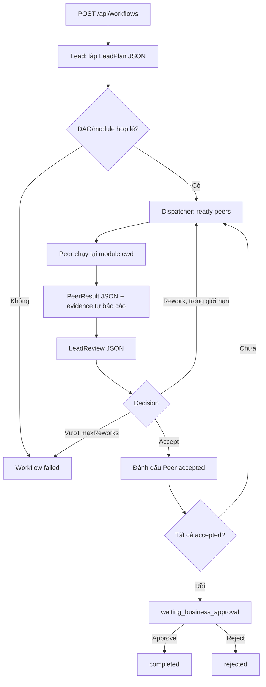

# P1 — Lead-controlled workflow

## Mục tiêu

Cho phép một yêu cầu từ Dashboard chạy thành **LeadPlan → Peer Tasks → LeadReview → Business Approval**. Lead và các Peer đều sử dụng Codex app-server, không dùng LLM API riêng.

## Luồng



## Contract JSON

**LeadPlan:**

```json
{
  "summary": "Triển khai feature đăng nhập",
  "tasks": [
    {
      "id": "api1",
      "title": "Tạo authentication endpoint",
      "moduleId": "api",
      "instructions": "Implement endpoint và tests",
      "dependsOn": []
    },
    {
      "id": "web1",
      "title": "Thêm login form",
      "moduleId": "web",
      "instructions": "Tích hợp endpoint mới",
      "dependsOn": ["api1"]
    }
  ]
}
```

**PeerResult:** `{ "summary": "...", "changedFiles": ["src/..."], "tests": [{ "command": "npm test", "status": "passed", "details": "..." }], "risks": [] }`.

**LeadReview:** `{ "summary": "...", "reviews": [{ "taskId": "api1", "decision": "accept", "feedback": "..." }] }`. Mỗi Peer trong batch phải có đúng một decision.

Output JSON được kiểm tra nghiêm ngặt; không parse prose pha JSON. Nếu invalid, Workflow chuyển `failed`, không tự bỏ qua review.

## Scheduler

- Plan chỉ cho phép 1–20 Peer tasks, `moduleId` phải tồn tại trong `config/workspace.local.json`.
- `dependsOn` phải là DAG, không tham chiếu sai taskId.
- Chỉ dispatch task có tất cả dependencies `accepted` bởi Lead.
- Tối đa **2 Peer đồng thời**, mỗi module chỉ **1 Peer** trong một batch.
- Khi Lead yêu cầu `rework`, chỉ Peer tương ứng chạy lại với feedback trước đó.
- `maxReworks=2`: tổng tối đa **3 attempts/Peer**; sau đó workflow failed.
- Bất kỳ lỗi runtime, invalid JSON hoặc review không đầy đủ đều khiến workflow failed. Không tự nhận completed.
- Workflow đang hoạt động khi backend restart được đánh dấu `interrupted`, **không tự dispatch lại**.

## API

| Method | Endpoint | Ý nghĩa |
|---|---|---|
| POST | `/api/workflows` | Tạo và bắt đầu workflow, body `{title,request}` |
| GET | `/api/snapshot` | Danh sách `workflows`, `tasks`, `approvals`, `events` |
| POST | `/api/workflows/:id/decision` | `{decision:"approve"|"reject"}` chỉ khi đang chờ duyệt |
| POST | `/api/tasks/:id/interrupt` | Dừng Turn của Peer/Lead đang chạy |
| GET | `/api/events` | SSE cập nhật khi state thay đổi |

Runtime Approval cho command/file-change sử dụng `/api/approvals/:id/decision` với `accept|decline`. Đây không phải Business Approval.

## Hạn chế và điều kiện kiểm chứng

- PeerResult là **self-report** của Agent. Backend chưa chạy xác minh độc lập diff, test hoặc output artifacts.
- Lead review nhận dữ liệu qua JSON; không tái sử dụng cùng Codex Thread cho các lượt planning/review.
- Các module là working directories thật, **không được tách worktree**. Chỉ nên thử ở repo đã commit sạch và trên máy đáng tin.
- Không hỗ trợ auto-recovery, resume và rollback sau runtime failure; P2 xử lý.
- Đã có mock executor để test DAG, giới hạn đồng thời, retry và approval. Test với Codex thật cần chạy trên máy đã đăng nhập.
