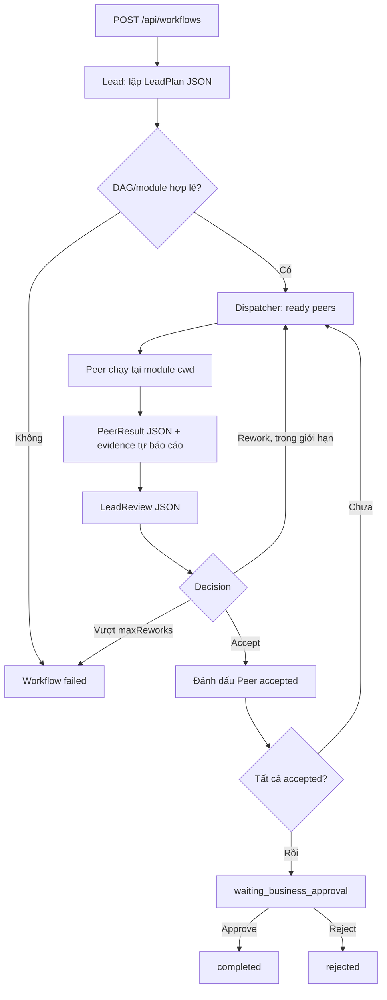

# P1 — Lead-controlled workflow

## Mục tiêu

Cho phép một yêu cầu từ Dashboard chạy thành **LeadPlan → Peer Tasks → LeadReview → Business Approval**. Lead và các Peer đều sử dụng Codex app-server, không dùng LLM API riêng.

## Luồng



## Contract JSON

**LeadPlan:**

```json
{
  "summary": "Triển khai feature đăng nhập",
  "tasks": [
    {
      "id": "api1",
      "title": "Tạo authentication endpoint",
      "moduleId": "api",
      "instructions": "Implement endpoint và tests",
      "dependsOn": []
    },
    {
      "id": "web1",
      "title": "Thêm login form",
      "moduleId": "web",
      "instructions": "Tích hợp endpoint mới",
      "dependsOn": ["api1"]
    }
  ]
}
```

**PeerResult:** `{ "summary": "...", "changedFiles": ["src/..."], "tests": [{ "command": "npm test", "status": "passed", "details": "..." }], "risks": [] }`.

**LeadReview:** `{ "summary": "...", "reviews": [{ "taskId": "api1", "decision": "accept", "feedback": "..." }] }`. Mỗi Peer trong batch phải có đúng một decision.

Output JSON được kiểm tra nghiêm ngặt; không parse prose pha JSON. Nếu invalid, Workflow chuyển `failed`, không tự bỏ qua review.

## Scheduler

- Plan chỉ cho phép 1–20 Peer tasks, `moduleId` phải tồn tại trong `config/workspace.local.json`.
- `dependsOn` phải là DAG, không tham chiếu sai taskId.
- Chỉ dispatch task có tất cả dependencies `accepted` bởi Lead.
- Tối đa **2 Peer đồng thời**, mỗi module chỉ **1 Peer** trong một batch.
- Khi Lead yêu cầu `rework`, chỉ Peer tương ứng chạy lại với feedback trước đó.
- `maxReworks=2`: tổng tối đa **3 attempts/Peer**; sau đó workflow failed.
- Bất kỳ lỗi runtime, invalid JSON hoặc review không đầy đủ đều khiến workflow failed. Không tự nhận completed.
- Backend thu thập thêm Git status trước/sau, diff preview (read-only), các command execution events và xác minh đường dẫn file nằm trong module.
- Workflow đang hoạt động khi backend restart được đánh dấu `interrupted`, **không tự dispatch lại**.

## API

| Method | Endpoint | Ý nghĩa |
|---|---|---|
| POST | `/api/workflows` | Tạo và bắt đầu workflow, body `{title,request}` |
| GET | `/api/snapshot` | Danh sách `workflows`, `tasks`, `approvals`, `events` |
| POST | `/api/workflows/:id/decision` | `{decision:"approve"|"reject"}` chỉ khi đang chờ duyệt |
| POST | `/api/tasks/:id/interrupt` | Dừng Turn của Peer/Lead đang chạy |
| GET | `/api/events` | SSE cập nhật khi state thay đổi |

Runtime Approval cho command/file-change sử dụng `/api/approvals/:id/decision` với `accept|decline`. Đây không phải Business Approval.

## Hạn chế và điều kiện kiểm chứng

- PeerResult là **self-report** của Agent. Backend bổ sung Git status/diff so với `HEAD`, kiểm tra đường dẫn artifact, **trích nội dung giới hạn từ file được Peer báo cáo (kể cả untracked)** và tool command events; đây **không phải** xác minh độc lập test đúng hay thay đổi riêng của từng attempt. Diff có thể chứa thay đổi của Peer trước cùng repository.
- Lead review nhận PeerResult **và PeerEvidence** qua JSON; không tái sử dụng cùng Codex Thread cho các lượt planning/review.
- Các module là working directories thật, **không được tách worktree**. Chỉ nên thử ở repo đã commit sạch và trên máy đáng tin.
- Không hỗ trợ auto-recovery, resume và rollback sau runtime failure; P2 xử lý.
- Đã có mock executor để test DAG, giới hạn đồng thời, retry và approval. Test với Codex thật cần chạy trên máy đã đăng nhập.

## YOLO mode cho Codex app-server

P1 sử dụng `approvalPolicy: "never"` và `danger-full-access` ở cả Thread/Turn để không dừng ở runtime approval. Hệ thống vẫn giữ Business Approval trước `completed`. **Lưu ý:** `cwd`/module allowlist chỉ định tuyến Agent, không cấm Codex đọc hoặc sửa nơi khác trên máy trong chế độ này. Không dùng với repo/đầu vào không tin cậy hoặc máy chứa dữ liệu chưa sao lưu.

## Giao thức Peer test & file handoff

- `tests[].status = "not_run"` được chấp nhận khi `command` rỗng, null hoặc không có. `passed/failed` yêu cầu `command` không rỗng.
- Peer không cần copy file vào Lead workspace. Backend truyền `modulePath`, `PeerResult`, `PeerEvidence` và bản xem trước nội dung các file được báo cáo.
- Backend chỉ đọc file hợp lệ nằm dưới module realpath; từ chối path traversal/symlink ra ngoài. Text preview có giới hạn dung lượng; file binary hoặc quá dài chỉ có metadata/note, không nạp toàn bộ vào prompt.
- Git diff `HEAD` không hiển thị file untracked. Bản xem trước file giúp Lead kiểm tra những file này.
- File previews là dữ liệu không tin cậy từ Peer module; Lead cần review và cân nhắc kết quả test riêng, không coi đây là kiểm chứng độc lập.


## Review format resilience

- LeadReview nhận danh sách `BATCH_TASK_IDS` chính xác từ trạng thái `review_pending`, không dùng ví dụ ID `api1` tĩnh.
- Validator vẫn yêu cầu đủ/đúng mỗi ID trong batch, không tự accept thiếu, không sử dụng quyết định cho Peer đã accepted.
- Khi Lead trả thiếu/thừa/sai JSON, backend chạy lại **Lead review** tối đa 2 lần cùng lỗi validator; `Peer` không chạy lại do lỗi format.
- Nếu hết retry, Workflow đánh dấu `failed` nhưng PeerResults vẫn giữ `review_pending`. Dashboard cho phép nhấn **Thử lại Lead Review** (`POST /api/workflows/:id/retry-review`), chỉ khi workflow failed và có PeerResult chờ review. Không chạy lại planning hoặc Peer.
- Rework của Peer (giới hạn `maxReworks`) khác với retry sửa schema của Lead; Lead format retry không làm tăng số lần Peer chạy.

## Final Integration Review + Acceptance Criteria

1. LeadPlan phải có `acceptanceCriteria` (1-12 tiêu chí, mỗi tiêu chí: `id,description,verification`) dựa trên yêu cầu gốc; không yêu cầu người dùng nhập schema.
2. Sau khi từng Peer được chấp nhận, Backend gọi Lead Final Integration Reviewer với yêu cầu gốc, các tiêu chí, modulePath, kết quả, file preview, Git/command evidence của **mọi** Peer.
3. `IntegrationReview` phải quyết định từng criterion ID đúng một lần, với `status=passed|failed|unverified` và `evidence` không rỗng; `verdict=pass|rework|manual_verification`.
4. `pass` chỉ được phép khi tất cả tiêu chí `passed`. `rework` cần criterion `failed` và Peer ID + feedback hợp lệ. Nếu không có failed nhưng còn unverified thì phải `manual_verification`.
5. Khi `rework`, Backend chạy lại Peer được chỉ định; các Peer downstream phụ thuộc vào Peer đó cũng bị chuyển về `rework` vì contract upstream có thể thay đổi. Tuân thủ giới hạn tối đa 2 rework/Peer.
6. Khi `manual_verification`, không hiển thị nút duyệt ngay. Người dùng phải xác nhận chính xác danh sách các acceptance criteria `unverified` qua `POST /api/workflows/:id/confirm-verification` với `{criterionIds:[]}`, sau đó mới có Business Approval. Có thể từ chối ngay tại bước này.
7. Tất cả quyết định của reviewer là đánh giá của Agent dựa trên evidence, **không phải test E2E tự động độc lập**. Không tuyên bố integration verified nếu chưa chạy các kiểm tra có ý nghĩa.

Lưu ý: Workflow cũ đã `waiting_business_approval` không tự động bị xem xét lại. Các workflow mới chạy qua bước review cuối; workflow đang `integration_reviewing` khi Backend restart được đánh dấu interrupted, không tự chạy lại.

### Phục hồi khi reviewer trả sai JSON

- Lead Planning và Final Integration Review đều có tối đa 2 lần sửa định dạng khi parse/validate thất bại. Chỉ chạy lại **Lead** ở các lượt này.
- Nếu Final Integration Review vẫn `failed` do sai JSON/schema nhưng mọi Peer vẫn `accepted`, có thể gọi `POST /api/workflows/:id/retry-integration`. Backend giữ nguyên source và PeerResult, chỉ gọi lại Final Integration Reviewer, rồi tiếp tục gate.
- Các lỗi runtime, vượt rework budget và lỗi khác **không** được phép dùng endpoint này.
